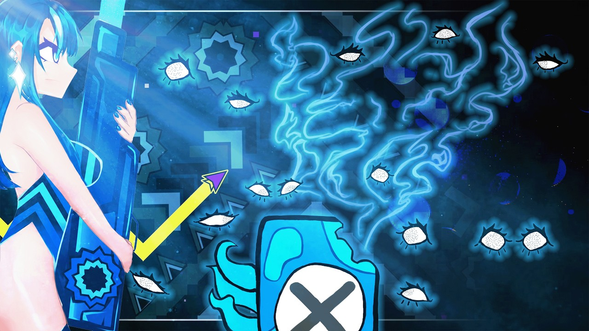
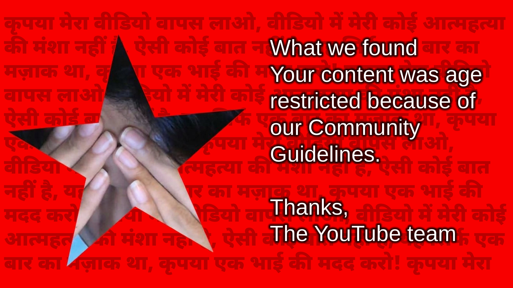
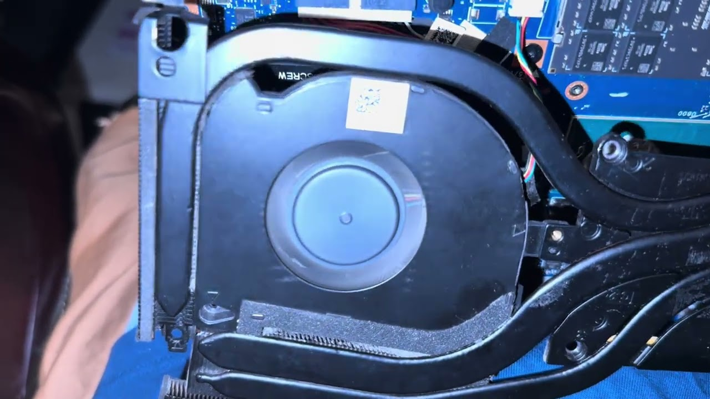
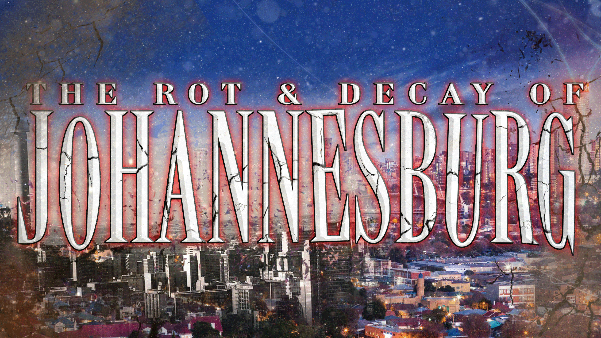

<b>NEFORUS</b> &nbsp;·&nbsp; YOUTUBE VIDEO ARCHIVE

# NEFORUS YOUTUBE ARCHIVE

### A living archive of all of my main video works on YouTube, until I die.

 

 

<table>
<tr>
<td align="center">
<a href="https://github.com/Neforuss/Neforus-YouTube-Video-Archive/blob/main/INDEX.md">
📼 &nbsp;THE FULL CATALOGUE 
<b><big>CHECK OUT THE ARCHIVE HERE &nbsp;→</big></b>
</a>
</td>
</tr>
</table>

 

**[Video Index](https://github.com/Neforuss/Neforus-YouTube-Video-Archive/blob/main/INDEX.md)** &nbsp;·&nbsp;
**[Web Archive](https://neforus.com/archive/)** &nbsp;·&nbsp;
**[Notes](#notes)** &nbsp;·&nbsp;
**[Rationale](#rationale)** &nbsp;·&nbsp;
**[Strikes](#fake-and-gay-strikes)** &nbsp;·&nbsp;
**[neforus.com](https://neforus.com/)**

 

LATEST UPLOADS

<!-- LATEST-UPLOADS:START -->
<table>
<tr>
<td align="center" width="33%"> <b>#668</b> · 2026-10-22 I beat the 2015 Demons List before Tride &amp; SONIC WAVE</td>
<td align="center" width="33%"> <b>#667</b> · 2026-10-13 Neforus dot com (my website)</td>
<td align="center" width="33%"> <b>#666</b> · 2026-09-29 How to appeal Community Guideline Strikes using HINDI</td>
</tr>
<tr>
<td align="center" width="33%"> <b>#665</b> · 2026-08-29 My laptop is retarded and I don’t know what to do</td>
<td align="center" width="33%"> <b>#664</b> · 2026-08-15 My Geometry Dash Demonlist Spreadsheet</td>
<td align="center" width="33%"> <b>#663</b> · 2026-07-26 The Rot and Decay of Johannesburg</td>
</tr>
</table>
<!-- LATEST-UPLOADS:END -->

Every video, thumbnail and mirror link lives in <a href="https://github.com/Neforuss/Neforus-YouTube-Video-Archive/blob/main/INDEX.md"><code>INDEX.md</code></a> and on <a href="https://neforus.com/archive/">neforus.com/archive</a>.

 

## About

A public repo that will record and redirect to multiple versions of videos I create and upload on YouTube primarily to different platforms, to minimize danger in case of any accounts getting wrongly banned.

| Platform | Role |
| :-- | :-- |
| **YouTube** | Original upload |
| **Rumble** · **Odysee** · **BitChute** · **Twitter/X** | Mirrors |
| **[INDEX.md](https://github.com/Neforuss/Neforus-YouTube-Video-Archive/blob/main/INDEX.md)** · **[neforus.com/archive](https://neforus.com/archive/)** | The record that links them all |

 

## Notes

> [!NOTE]
> **[WRITTEN ON JULY 23 2026]**
>
> I am forgoing the retroactive uploads for older videos until I can hire someone who can:
>   1. Have the patience to do this task
>   2. Make better thumbnails for videos at their best discretion
>   3. Have the discretion to make better titles and appropriate descriptions for every video that is on my youtube channel library.
>   4. Do it within 1 week or less
>   5. Demonstrate attention to detail in terms of linking the mirrors to each and every upload and a good judgement to skip confusing videos that will mess up the order given some videos on my channel have been permanently deleted or banned.
>
> I will only focus on mirroring only the most current videos I publish, this task is too tedious.

> [!IMPORTANT]
> **[WRITTEN ON OCTOBER 13 2026]**
>
> THIS ENTIRE TASK IS BEING DONE BY CHATGPT!

 

## RATIONALE

The reason why I am choosing to have an elaborate archive of my own videos is the fact that I have had a history of false copyright strikes and bogus Community Guideline strikes.

Though I do want people to know that I AM THE PROBLEM in this case. I am fully aware 100% of the ones that aren’t spurious do have legitimate reason and ARE MY FAULT, it’s just that I live in a mindset that is 10 years older than I am when I am posting videos in regard to the rules and what was allowed to be posted on YouTube and on the Internet as a whole during that time and earlier. Not a justification or excuse, it’s a reason.

> [!WARNING]
> At one point I was on a TWO STRIKES standing with the Community Guidelines, on the verge of being nuked off of YouTube for what started out as an unfortunate line of videos that got taken down for reasons that are going to be shown in the screenshots.

 

## FAKE AND GAY STRIKES

| # | Reason given | Outcome |
| :-: | :-- | :-- |
| 01 | Copyright (Onision) | False copyright strike |
| 02 | Cyberbullying / Harassment | **STRIKE 1** |
| 03 | Child Safety | [RESOLVED](https://youtu.be/SLFSc4lBTso) |
| 04 | Medical Misinformation | **STRIKE 2** |
| 05 | Violent criminal organizations policy | — |
| 06 | Policy on harmful conspiracy theories | [WAS RESOLVED](https://www.youtube.com/watch?v=0xNu2tDHuJg) |
| 07 | Violent criminal organizations policy | — |

---

### 01 · Copyright

Onision False Copyright Strike on a video that was of his mental breakdown vocoded to the song Oingo Boingo - Little Girls

---

### 02 · Cyberbullying / Harassment &nbsp;`STRIKE 1`

“Cyberbullying/Harassment” Community Guideline Strike on a Livestream Covering the EDP445 Situation at the time. At the time other people have gotten similar strikes to mines. STRIKE 1

---

### 03 · Child Safety &nbsp;`RESOLVED`

“Child Safety” CG Strike, most likely was the part in the video where visibly of age people were playing with fire. [RESOLVED](https://youtu.be/SLFSc4lBTso)

---

### 04 · Medical Misinformation &nbsp;`STRIKE 2`

"Medical Misinformation" off of me playing an RFK Joe Rogan Clip deep in a livestream when the gay COVID-19 misinformation policy was a very prevelant force. STRIKE 2

---

### 05 · Violent Criminal Organizations

"Violent criminal organizations policy" because the video was titled 'What is the GD Dream?' mistaking GD for Gangster Disciple when it was a Geometry Dash video.

---

### 06 · Harmful Conspiracy Theories &nbsp;`WAS RESOLVED`

"Policy on harmful conspiracy theories" for a video titled "LAW AND ORDER LITERALLY HAD A PIZZAGATE EPISODE TO PSYOP YOU ALL LMAOOOOO" when it was just a Geometry Dash level completion, nothing to do with Pizzagate. [WAS RESOLVED](https://www.youtube.com/watch?v=0xNu2tDHuJg)

---

### 07 · Violent Criminal Organizations

"Violent criminal organizations policy" for me writing the first section of the Unabomber Manifesto deep in a livestream, when, and I know I don't need to look for this, there are videos praising him on the same platform when my infraction was simply a part of a writing exercise.

 

---

**[Browse the full archive →](https://github.com/Neforuss/Neforus-YouTube-Video-Archive/blob/main/INDEX.md)**

<a href="https://neforus.com/">neforus.com</a> &nbsp;·&nbsp; <a href="https://neforus.com/archive/">neforus.com/archive</a> &nbsp;·&nbsp; <a href="https://neforus.substack.com/">Substack</a>

